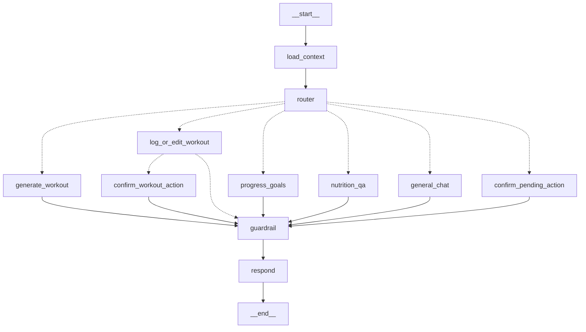

# Fitness Coach

A fitness web app built with Next.js. It includes an exercise library, a workout generator, an exercise video explorer, and an AI coach with persistent chat sessions.

## Features

| Page | Route | Description |
| --- | --- | --- |
| Home | `/` | Landing page |
| Exercise Library | `/pages/exercise` | Searchable/filterable exercise browser (category, equipment, muscle) with infinite scroll |
| Workout Generator | `/pages/exercise` (generator) | Builds timed workouts from local exercise pools by duration, type, target area, and intensity |
| Videos | `/pages/videos` | Exercise video explorer |
| AI Coach | `/pages/ai-coach` | Chat with a fitness-focused LLM assistant; sessions are stored server-side per device |
| Nutrition / Progress / Disclaimer | `/pages/nutrition`, `/pages/progress`, `/pages/disclaimer` | Static/info pages |

## Tech Stack

| Tool | Version | Purpose |
| --- | --- | --- |
| [Next.js](https://nextjs.org) | 16.3.0 | App Router framework, Turbopack builds, Cache Components (`cacheComponents: true`), API routes |
| [React](https://react.dev) | 19.2.8 | UI (React Compiler enabled via `babel-plugin-react-compiler`) |
| [TypeScript](https://www.typescriptlang.org) | 5.x | Type safety |
| [Tailwind CSS](https://tailwindcss.com) | 4.x | Styling (`@tailwindcss/postcss`) |
| [ESLint](https://eslint.org) | 9 + `eslint-config-next` | Linting |
| [node-postgres (`pg`)](https://node-postgres.com) | 8.x | PostgreSQL connection pool for chat persistence |
| [LangGraph](https://www.npmjs.com/package/@langchain/langgraph) | ^1.4 | Orchestrates the AI-coach chat graph (`@langchain/langgraph` + `@langchain/core`) |

Requires Node.js >= 20.9.0.

## External Data Sources

### wger REST API v2 — https://wger.de/api/v2/

The primary exercise data source (free/open API). Endpoints used:

- `GET /exerciseinfo/?language=2` — exercises with category, muscles, equipment, images, translations (exercise library page)
- `GET /exercisecategory/` — category filter chips
- `GET /equipment/` — equipment filter chips
- `GET /muscle/` — muscle filter chips and muscle metadata (`image_url_main`, `image_url_secondary`, `is_front`)
- Video endpoints (videos page, see `src/lib/server/videos.ts`) with results cached via Next.js `cacheLife`/`cacheTag`

Exercise photos are loaded directly from `wger.de/media/exercise-images/...`.

### AI Providers

Pluggable provider layer in `src/lib/server/ai/providers/` (plain REST calls, no SDK):

- **Google Gemini** — `generativelanguage.googleapis.com` (`GOOGLE_GEMINI_KEY`, model via `GEMINI_MODEL`)
- **xAI Grok** — `GROK_API_KEY`
- **DeepSeek** — `DEEPSEEK_API_KEY`

The active provider is chosen via the `AI_PROVIDER` env var or auto-detected from whichever key is configured.

### LangGraph coaching workflow

Every AI-coach message runs through a shared
[LangGraph](https://www.npmjs.com/package/@langchain/langgraph) `StateGraph`
defined in `src/lib/server/ai/graph.ts`. The app's lightweight
`{ role, content }` messages are converted to LangChain `BaseMessage`s at the
boundary in `src/lib/server/chat.ts`, so the graph is provider-agnostic and works
for all AI tools.

Graph shape: `START → retrieve_exercises → agent → (conditional) → END | fallback → END`

- **retrieve_exercises** runs retrieval-augmented search over the wger exercise
  library (see "Exercise retrieval" below) and writes the top matches to state.
- **agent** resolves the requested provider and streams its reply through the
  model adapter in `src/lib/server/ai/multiplexed-model.ts`. The reply is a
  JSON envelope (`{"reply", "referenced_exercise_ids"}`) parsed by the graph so
  the frontend can render exercise cards for the ids the coach actually used.
- A deterministic **safety gate** (in `agent`) detects out-of-scope topics
  (suspected injury, medical symptoms, unsafe load, etc.) and routes to the
  **fallback** node, which hands the conversation to a qualified human coach
  instead of answering with the model.

Because providers are plain single-string REST adapters, the human hand-off uses
the deterministic gate rather than LLM tool-calling. The graph itself still
renders/compiles through LangGraph's standard `StateGraph` API, so adding
tool-calling providers later is a drop-in change. The packages are listed in
`serverExternalPackages` in `next.config.ts` so they're not bundled by Next.js.

### Intent-routed coach graph (v2, feature-flagged)

`src/lib/server/ai/graph-v2.ts` adds an intent router on top of the same
LangGraph primitives. It is OFF by default (`COACH_GRAPH_MODE=legacy`); the
legacy plan-aware graph above keeps serving traffic until the v2 tests pass in
your environment.

<!-- coach-graph-v2:start -->
<!-- Generated from the compiled graph by `npm run graph:diagram`. Do not edit by hand. -->


<!-- coach-graph-v2:end -->

`log_or_edit_workout` passes through `confirm_workout_action` before the
guardrail because the graph pauses on `interrupt()` until the user confirms the
write. The earlier hand-written diagram omitted that gate; the generated one is
authoritative. Conditional edges are dotted because LangGraph's `drawMermaid()`
does not emit their labels.

- **Models by role** live in `src/ai/models.ts`: `router` (cheap/fast),
  `planner` (structured plan work), `chat` (conversation). Each role has a
  primary provider plus an automatic `.withFallbacks()` chain, and every call
  logs the provider/model that answered.
- **Tools** in `src/lib/server/ai/tools.ts` are thin wrappers around existing
  services. `log_or_edit_workout` calls the same `workout-logs.ts` module as
  `POST/DELETE /api/progress/workouts`, so "complete workout → auto-log → update
  all mapped goals → undo" has exactly one implementation.
- **Persistence** uses the app's Postgres database via
  `@langchain/langgraph-checkpoint-postgres`; `thread_id` is the chat session id.
  Set `COACH_CHECKPOINTER=memory` to use `MemorySaver` (dev/tests).
- **Streaming** (`POST /api/coach/stream`) is behind `COACH_SSE_ENABLED=true` and
  maps LangGraph `streamMode: "messages"` chunks to SSE `token` events, followed
  by a `message` event with the final turn payload.

Enable it with:

```bash
COACH_GRAPH_MODE=langgraph
COACH_SSE_ENABLED=true        # optional, only for the SSE endpoint
```

#### Adding a graph node

1. Add the intent to `INTENTS` in `src/lib/server/ai/intents.ts`.
2. Write the node function in `graph-v2.ts` (return `output` and `messages`).
3. Register it with `.addNode(...)` and add it to the `routeFromRouter` switch
   and the conditional-edge map, plus the `guardrail → respond` edge.
4. Add a router-accuracy case in `graph-v2.test.ts`.

#### Adding a model provider

1. Add the name to `MODEL_PROVIDERS` in `src/ai/models.ts`.
2. Return its key/model/base URL from `providerEnv()`.
3. Construct the LangChain chat model in `buildChatModel()` (use the provider's
   `@langchain/*` package; OpenAI-compatible providers can reuse `ChatOpenAI`
   with a `baseURL`).
4. Add it to `AI_MODEL_FALLBACKS` and, optionally, set
   `AI_<ROLE>_PROVIDER` / `AI_<ROLE>_MODEL` to make it a role's primary.

### Exercise retrieval (RAG)

The coach is grounded in the wger exercise database instead of guessing exercise
names, muscles, or form cues:

- `npm run build:index` — one-time indexing step (re-run only when
  `public/data/wger-exerciseinfo.json` changes). Loads every exercise, builds a
  text document (name + category + muscles + equipment + description), embeds it,
  and writes `data/exercise-index.json`.
- At runtime the index is loaded from disk once and searched in memory; the only
  per-request network call is embedding the search query. The embedding provider
  is swappable via a single constant in
  `src/lib/server/ai/exercise-embeddings.ts` (`EMBEDDING_MODEL`,
  `EMBEDDING_DIMENSIONS`).
- `npm run test:retrieval` — runs a few sample queries and prints the top hits
  so retrieval quality can be sanity-checked.

### Database

PostgreSQL stores AI coach chat sessions/messages (`chat_sessions`, `chat_messages`). The schema is created automatically on first use (`src/lib/server/db.ts`).

## Local Assets

- `public/exercise/` — mirrored wger exercise photos (UUID-named files matching wger image UUIDs)
- `public/exercise/images.json` — mapping of `{ image_id, file, exercise_id, name, type }` used as an offline fallback so images still render when the wger API is unavailable
- `public/exercise/placeholders/` — generated SVG placeholders per category (abs, arms, back, calves, cardio, chest, legs, shoulders + generic)
- `public/exercise/muscles/` — wger anatomy SVGs: front/back body silhouettes plus `main-{id}.svg` / `secondary-{id}.svg` overlays for each of the 15 muscle IDs, composed at runtime by `src/components/MuscleDiagram.tsx`
- `public/videos/` — mirrored exercise videos
- `src/data/exercisesList.json` — warmup/workout/cooldown exercise pools for the workout generator

## Exercise Image Fallback Chain

Every exercise resolves a visual in this order (see `src/app/pages/exercise/page.tsx`):

1. Photo from the wger API response
2. Local mirror lookup via `images.json`
3. Muscle highlight diagram (composed from the exercise's primary/secondary muscles using `MuscleDiagram`)
4. Category placeholder SVG

## Getting Started

```bash
npm install
npm run dev     # development server on http://localhost:3000
```

### Environment Variables (`.env.local`)

| Variable | Required | Description |
| --- | --- | --- |
| `DATABASE_URL` | Yes (AI coach only) | PostgreSQL connection string |
| `DATABASE_SSL` | No | Set to `"true"` to enable SSL with relaxed verification |
| `AI_PROVIDER` | No | `gemini` (default), `grok`, or `deepseek` |
| `GOOGLE_GEMINI_KEY` | For Gemini | Google AI Studio API key |
| `GEMINI_MODEL` | No | Defaults to `gemini-3.5-flash-lite` |
| `EMBEDDING_MODEL` | No | Embedding model; defaults to `gemini-embedding-001` |
| `EMBEDDING_DIMENSIONS` | No | Embedding vector length; defaults to `768` |
| `GROK_API_KEY` | For Grok | xAI API key |
| `DEEPSEEK_API_KEY` | For DeepSeek | DeepSeek API key |
| `AI_ROUTER_PROVIDER` / `AI_ROUTER_MODEL` | No | v2 intent router; defaults to Gemini |
| `AI_PLANNER_PROVIDER` / `AI_PLANNER_MODEL` | No | v2 plan/workout-action nodes |
| `AI_CHAT_PROVIDER` / `AI_CHAT_MODEL` | No | v2 conversational nodes |
| `AI_MODEL_FALLBACKS` | No | Comma-separated provider order, e.g. `gemini,deepseek,xai` |
| `AI_REQUEST_TIMEOUT_MS` | No | Per-model-call timeout; defaults to `60000` |
| `COACH_GRAPH_MODE` | No | `legacy` (default) or `langgraph` (v2) |
| `COACH_CHECKPOINTER` | No | `memory` forces `MemorySaver`; default uses Postgres when `DATABASE_URL` is set |
| `COACH_SSE_ENABLED` | No | `true` enables `POST /api/coach/stream` |
| `LANGSMITH_TRACING` / `LANGSMITH_API_KEY` | No | Optional LangSmith tracing |

### Scripts

```bash
npm run dev     # start dev server
npm run build   # production build (Turbopack)
npm run start   # serve production build
npm run lint    # eslint
npm run build:index    # (re)build data/exercise-index.json from wger data
npm run test:retrieval # sanity-check exercise retrieval quality
```

## Project Structure

```
src/
├── app/
│   ├── api/
│   │   ├── videos/                 # cached video feed endpoint
│   │   └── chat/                   # providers list + session/message CRUD
│   └── pages/                      # app pages (exercise, videos, ai-coach, ...)
├── components/                     # UI components incl. MuscleDiagram, ai-coach/, videos/
├── data/                           # workout generator exercise pools
└── lib/
    ├── workout.ts                  # workout generation logic
    └── server/                     # db pool, chat store, video fetching, AI providers
```

## Credits

- Exercise data, images, videos, and anatomy SVGs: [wger](https://wger.de) (open-source fitness platform, AGPL license)
- Body silhouettes and muscle overlay SVGs from the [wger GitHub repository](https://github.com/wger-project/wger)
