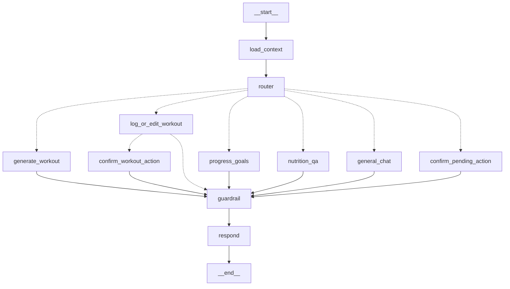

# Coach graph v2

The diagram below is generated from the compiled LangGraph graph, not drawn
by hand. Regenerate it with `npm run graph:diagram`; CI can run
`npm run graph:diagram:check` to reject a stale copy.

`log_or_edit_workout` intentionally passes through `confirm_workout_action`
before the guardrail: the graph pauses on `interrupt()` until the user
confirms the write. Conditional-edge labels are not emitted by
LangGraph's `drawMermaid()`, so the branches appear as dotted edges.

<!-- coach-graph-v2:start -->
<!-- Generated from the compiled graph by `npm run graph:diagram`. Do not edit by hand. -->

<!-- coach-graph-v2:end -->
